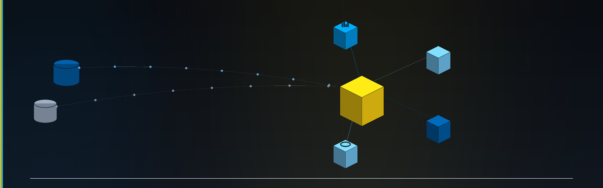

  

  
  
  
  
  

# 📊 Financial Sample — Modelagem Dimensional com Power BI

> **AI Engineer | Especialista em Governança 4.0 e Qualidade | Engenheiro Químico**  
> [Mauá, SP](mailto:ornelas.tozato@gmail.com) | [LinkedIn](https://www.linkedin.com/in/rafaeltozato81) | [GitHub](https://github.com/Rafael-TOZATO) | [Portfólio PWA](https://tozato-dev-hub.vercel.app) | [Medium](https://medium.com/@ornelas.tozato)

## Sobre o projeto

Este projeto foi desenvolvido a partir do desafio da DIO **“Integrando Dados com MySQL Azure e Transformando com Power BI”**, utilizando a base **Financial Sample**.

O objetivo foi transformar uma tabela única de origem em um modelo dimensional organizado no formato **Star Schema**, separando informações de dimensões e fatos e realizando as transformações necessárias para análise dos dados no Power BI.

## Objetivos

- Estruturar os dados em um modelo dimensional.
- Criar tabelas de dimensão e fato.
- Organizar e transformar os dados utilizando Power Query.
- Criar a dimensão calendário com DAX.
- Estruturar os relacionamentos do modelo.
- Reorganizar as colunas para facilitar a análise.
- Documentar o processo de construção do modelo.
- Desenvolver uma estrutura adequada para análise de dados e Business Intelligence.

## Estrutura do modelo

O projeto foi estruturado com as seguintes tabelas:

### `Financials_origem`
Tabela original utilizada como base para a construção do modelo. Foi mantida no projeto como **backup e referência**, permanecendo oculta no modelo final.

### `D_Produtos`
Dimensão responsável pelas informações consolidadas dos produtos, incluindo:
- ID do produto
- Produto
- Média de unidades vendidas
- Média do valor de vendas
- Mediana do valor de vendas
- Valor máximo de venda
- Valor mínimo de venda

### `D_Produtos_Detalhes`
Contém informações detalhadas relacionadas aos produtos:
- ID do produto
- Discount Band
- Sale Price
- Units Sold
- Manufactoring Price

### `D_Descontos`
Dimensão relacionada às informações de desconto:
- ID do produto
- Discount
- Discount Band

### `D_Detalhes`
Tabela destinada às informações complementares que não foram contempladas nas demais dimensões, permitindo preservar detalhes relevantes da base original.

### `D_Calendário`
Dimensão de calendário criada utilizando **DAX**, por meio da função `CALENDAR()`. A dimensão permite estruturar informações temporais para análises baseadas em datas.

### `F_Vendas`
Tabela fato responsável por concentrar os principais registros utilizados na análise de vendas, incluindo:
- ID do produto
- Produto
- Units Sold
- Sales Price
- Discount Band
- Segment
- Country
- Salers
- Profit
- Date

## Modelo Star Schema

O modelo foi organizado seguindo o conceito de **Star Schema**, mantendo a tabela fato como núcleo do modelo e as tabelas dimensionais ao seu redor.

## Processo de construção

O desenvolvimento foi realizado seguindo as etapas propostas no desafio:
1. Importação da base Financial Sample.
2. Criação de cópias da tabela original.
3. Seleção das colunas necessárias para cada dimensão.
4. Criação das tabelas dimensionais.
5. Construção da tabela fato.
6. Tratamento e transformação dos dados no Power Query.
7. Ajuste dos tipos de dados.
8. Reorganização das colunas.
9. Criação da dimensão calendário utilizando DAX.
10. Estruturação do modelo no formato Star Schema.
11. Organização visual do modelo no Power BI.
12. Salvamento do projeto `.pbix`.
13. Registro visual do modelo para documentação.
14. Documentação do projeto neste repositório.

## Power Query

Durante o processo de transformação foram realizados tratamentos como:
- definição dos tipos de dados;
- conversão de campos para texto, número e data;
- organização das colunas;
- tratamento de informações necessárias ao modelo;
- preparação das tabelas para utilização no modelo dimensional.

O Power Query foi utilizado como etapa de preparação e transformação dos dados antes da modelagem.

## DAX

A dimensão calendário foi criada utilizando a função CALENDÁRIO.

## 📬 Contatos

- 💼 **LinkedIn:** [rafaeltozato81](https://www.linkedin.com/in/rafaeltozato81)
- 🐙 **GitHub:** [Rafael-TOZATO](https://github.com/Rafael-TOZATO)
- ✍️ **Medium:** [@ornelas.tozato](https://medium.com/@ornelas.tozato)
- 🌐 **Portfólio PWA (Dev Hub):** [tozato-dev-hub.vercel.app](https://tozato-dev-hub.vercel.app)
- 🌐 **H-Folio:** [h-folio-psi.vercel.app](https://h-folio-psi.vercel.app)
- 🚀 **Aurora BI (Lovable):** [aurora-bi-dio.lovable.app](https://aurora-bi-dio.lovable.app)
- 📜 **Microsoft Learn:** [Transcript](https://learn.microsoft.com/pt-br/users/rafaelornelastozato-2209/transcript/dzo2wizrzkx2853)
